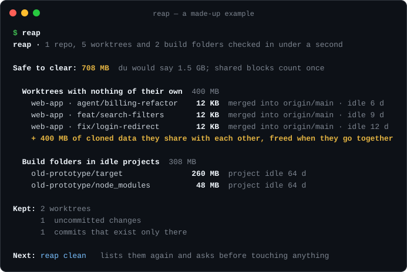
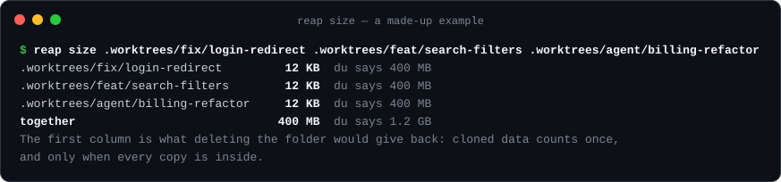

# reap

[](https://github.com/johnmikel/reap/actions/workflows/ci.yml)

**Clear the git worktrees your coding agents left behind, but only the ones that are really finished.**



Coding agents and `git worktree add` leave a checkout behind for every task. Disk cleaners can see those folders, but not whether the work in them exists anywhere else. reap asks git: no uncommitted changes, every commit merged, no env file of its own, nothing running inside, idle for days. Only those worktrees are offered, and they go to the Trash.

It also tells you what clearing them really gives back. Worktrees often share their `node_modules` or `target` as APFS clones, so `du` counts the same bytes again and again. On one real Mac with 251 worktrees, `du` said 74 GB could be cleared. reap measured 23 GB. A cautious clean took free space from 100 GiB to 110 GiB.

## Install

```bash
brew install johnmikel/tap/reap
```

Or build it with Rust: `cargo install --git https://github.com/johnmikel/reap`. Prebuilt binaries for macOS (Apple silicon and Intel in one file) and Linux are on the [releases page](https://github.com/johnmikel/reap/releases).

## Use

```bash
reap                 # report only: what is safe to clear, and what it really frees
reap clean           # list it again, ask, then clear
reap size PATH...    # what deleting any folder would really free, next to du
```

`reap size` works on any folder, not just worktrees:



## Safe around coding agents

reap offers a worktree only when it holds nothing that exists nowhere else:

- It has no uncommitted or untracked changes.
- Every commit is merged into the remote's main branch. In repositories without a close hook, pushed to any remote branch also counts.
- It has no env file (`.env`, `.env.local`, `.dev.vars`, …) that differs from the main checkout's copy.
- No program is running inside it: an agent mid-task, a dev server or a shell all keep it.
- It has had no git activity for `--idle` days (default 3).

reap reads git with `--no-optional-locks`, so a scan never rewrites the index of a worktree someone else is using. reap checks again for running programs just before it clears anything.

To let an agent tidy up after itself, copy [`skills/reap`](skills/reap/SKILL.md) into your agent's skills folder (for Claude Code, `~/.claude/skills/reap`). The agent runs the report, shows you what it found and clears only after you say yes.

reap also offers build folders (`node_modules`, Rust `target`, `.next`, `.turbo`, `.expo`, `.venv`, `Pods`, …) once their project has been idle for `--days` (default 30). With `--xcode`, it also offers Xcode DerivedData that hasn't been touched for two weeks.

## How clean works

`reap clean` lists everything again and asks before touching anything. Folders move to a dated `reap <date>` folder in the Trash, and reap prunes git's record of each moved worktree. Nothing is deleted outright: the space comes back when you empty the Trash.

## Close hooks

Some teams close worktrees with their own script, one that also deletes the merged branch or updates a tracker. You can point reap at it in `~/.config/reap/config`:

```text
root = ~/code                 # where to look when no folder is given
xcode = true                  # also check Xcode's DerivedData
close ~/work = ~/work/scripts/close-worktree {repo} {branch} {base}
```

For repositories under `~/work`, finished worktrees go through that command instead of the Trash. reap fills in `{repo}`, `{path}`, `{branch}` and `{base}`, shell-quoted. It hands over only worktrees merged into the base, and the hook's own checks have the last word: anything the hook refuses is listed and left alone.

## How sizes work

For each file, reap asks macOS how many bytes only that file holds, and which clone family it belongs to. Shared data counts once, and only when every file sharing it is inside what's being cleared. That's why, in the screenshot above, each worktree alone frees 12 KB but the three together free 400 MB. Hard-linked files count toward the `du` figure only, since their other links may live elsewhere.

Clone-aware sizing needs macOS and APFS. On other systems, reap does everything else the same but reports allocated sizes, like `du`.

## Related tools

- [Mole](https://github.com/tw93/Mole) is a full Mac cleaner: caches, app leftovers, a disk explorer, and `mo purge` for build folders. Use it for general cleanup. It doesn't look at git worktrees, which is the part reap does.
- [gh-reaper](https://github.com/ai-ecoverse/gh-reaper) also finds stale worktrees, and can ask GitHub whether a branch's pull request was squash-merged. reap can't detect squash merges, so use gh-reaper if your team squash-merges.
- `git worktree prune` removes git's records of worktrees whose folders are already gone. reap finds the ones that still exist.

## Options

| Option | Default | Meaning |
| --- | --- | --- |
| `ROOT...` | config roots, else this folder | where to look for repositories and projects |
| `--idle N` | 3 | days without git activity before a finished worktree counts |
| `--days N` | 30 | days a project must be idle before its build folders count |
| `--xcode` | off | also check Xcode's DerivedData |
| `--all` | off | list every item, kept worktrees and their reasons included |
| `--dry-run` | off | with `clean`: show the list and stop |
| `--yes` | off | with `clean`: skip the question |

The screenshots come from a made-up example: three finished worktrees whose `node_modules` are APFS clones of each other, two worktrees still in use, and a prototype untouched for two months.

MIT licensed. reap uses only the Rust standard library.
